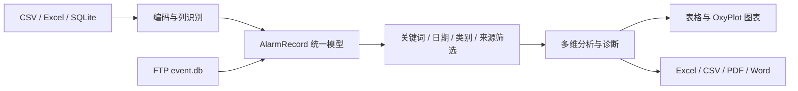

# 报警日志智能分析工具（AlarmAnalysisTool）

面向威纶通（Weinview）HMI 报警日志的 Windows 桌面分析工具，用于把 CSV、Excel 和 SQLite 日志转换成统一的分析数据，完成报警频次、趋势、持续时间、设备来源、关联关系和异常模式分析，并导出 Excel、CSV、PDF 或 Word 报告。

| 项目 | 说明 |
| --- | --- |
| 应用类型 | WPF 桌面应用 |
| 目标框架 | `net6.0-windows7.0` |
| 程序集版本 | `1.0.0.0` |
| 默认界面语言 | 简体中文 |
| 数据存储 | 导入数据仅保存在当前进程内存中 |
| 外部通信 | 仅在使用 FTP 实时采集时连接用户配置的 FTP 服务器 |

## 功能概览

- 支持多文件 CSV 导入，自动识别 UTF-8、UTF-16、GB18030/GBK 编码，以及逗号、分号、Tab 分隔符。
- 支持 Excel 首个工作表的列映射、前 5 行预览和自动字段识别。
- 支持威纶通 HMI `event.db` 格式的单个或多个 SQLite 数据库导入，并可按时间范围筛选。
- 支持通过 FTP 定时下载远程 `event.db`，按服务器展示实时报警表，不覆盖历史分析数据。
- 自动识别报警码、报警描述、类别名称和主设备来源。
- 提供关键词、日期、报警类别和设备来源组合筛选，并在筛选后重新分析。
- 提供频次排行、类别分布、24 小时分布、按日趋势、持续时间、设备来源、未恢复报警和报警关联分析。
- 基于高频、通讯异常、长时间持续、未恢复、来源集中、时间集中、报警风暴和多日趋势生成诊断建议。
- 导出多 Sheet Excel 报告、原始数据 CSV、A4 PDF 报告和 Word 文档。
- 导入完成后自动执行分析；也可点击“重新分析”重新计算全部结果。

## 目录

- [运行环境](#运行环境)
- [快速开始](#快速开始)
- [界面与基本流程](#界面与基本流程)
- [历史数据分析](#历史数据分析)
- [数据筛选](#数据筛选)
- [FTP 实时采集](#ftp-实时采集)
- [导出报告](#导出报告)
- [数据格式](#数据格式)
- [分析规则](#分析规则)
- [构建与发布](#构建与发布)
- [配置与缓存目录](#配置与缓存目录)
- [常见问题](#常见问题)
- [安全与隐私](#安全与隐私)
- [已知限制](#已知限制)
- [项目结构](#项目结构)
- [第三方组件与许可](#第三方组件与许可)

## 运行环境

### 直接运行已发布版本

根据发布方式选择对应条件：

| 发布方式 | 目标机器要求 |
| --- | --- |
| 单文件、自包含 | 64 位 Windows，无需预装 .NET |
| 自包含文件夹 | 64 位 Windows，无需预装 .NET |
| 框架依赖 | 64 位 Windows + .NET 6 Desktop Runtime |

建议使用 Windows 10 或 Windows 11。项目的目标框架字符串包含 `windows7.0`，但 .NET 6 已停止官方支持，因此不建议在联网生产环境长期使用。

.NET 6 Desktop Runtime 下载地址：

<https://dotnet.microsoft.com/download/dotnet/6.0>

### 从源码构建

需要：

- Windows 10/11
- Visual Studio 2022，并安装“.NET 桌面开发”工作负载；或
- .NET 6 SDK 及对应 Windows Desktop 构建组件

验证 SDK：

```powershell
dotnet --info
```

## 快速开始

1. 启动 `XYR_AlarmAnalysisTool.exe`。
2. 切换到“历史报警分析”。
3. 点击“CSV文件”“Excel文件”或“数据库文件”导入报警日志。
4. 检查文件信息、时间范围和自动生成的分析概览。
5. 按需设置筛选条件，然后点击“筛选”。
6. 查看报警频次、趋势、持续时间、关联分析和智能诊断。
7. 通过“完整报告(Excel)”“PDF报告”“Word报告”或“原始数据(CSV)”导出结果。

如需实时监控现场 HMI，可切换到“实时采集监控”，先配置 FTP 服务器，再点击“立即采集”或启用自动采集。

## 界面与基本流程

应用包含两个主区域：

| 区域 | 用途 |
| --- | --- |
| 实时采集监控 | 配置 FTP 服务器、手动或定时下载 `event.db`、查看各服务器最新报警 |
| 历史报警分析 | 导入历史文件、筛选、分析、查看图表和导出报告 |

整体数据处理流程：



导入成功后，应用会自动分析并向“原始数据”“智能分析”等区域填充结果。

## 历史数据分析

### CSV 导入

1. 点击“CSV文件”。
2. 可同时选择多个 `.csv` 文件。
3. 应用自动检测编码、分隔符和标准列。
4. 导入完成后自动分析。

CSV 使用自动列映射，不弹出人工映射窗口。建议使用标准列名或其中文显示名，例如“事件”“类别”“触发日期”“信息”。

支持：

- BOM UTF-8、UTF-16 LE、UTF-16 BE。
- 无 BOM 的 UTF-8。
- 无 BOM 且非 UTF-8 时回退到 GB18030，兼容 GBK/GB2312 工业现场导出文件。
- `,`、`;`、Tab 分隔符。
- 双引号包裹的字段和双引号转义。
- 多文件合并导入。

### Excel 导入

1. 点击“Excel文件”。
2. 选择 `.xlsx` 文件。
3. 在列映射窗口中检查“标准字段 → Excel列”的对应关系。
4. 可点击“自动检测”重新识别，也可手动调整。
5. 查看前 5 行数据预览，确认后点击“确定导入”。

说明：

- 只读取第一个工作表。
- 默认第 1 行为表头，从第 2 行开始读取数据。
- 当前使用 ClosedXML 读取 Excel 2007+ Open XML 文件。旧版二进制 `.xls` 请先另存为 `.xlsx`。
- 单次 Excel 导入选择一个文件；多个工作簿可分别导入或合并为 CSV 后使用多文件导入。

### SQLite 导入

1. 点击“数据库文件”。
2. 可同时选择多个 `.db`、`.sqlite` 或 `.sqlite3` 文件。
3. 应用读取所有数据库中的时间范围。
4. 在日期范围窗口中选择全部导入或指定起止日期。
5. 导入完成后自动分析。

当前 SQLite 导入器针对威纶通 HMI 的 `event.db` 数据库结构设计，不是任意 SQLite 表的通用导入器。库结构和字段要求见[SQLite 数据格式](#sqlite-数据格式)。

## 数据筛选

历史分析区支持以下条件：

| 条件 | 说明 |
| --- | --- |
| 开始日期 | 包含所选日期 |
| 结束日期 | 包含所选日期全天 |
| 报警类别 | 基于从“信息”字段解析出的类别名称多选 |
| 设备来源 | 基于解析出的主设备名多选，例如 `EM03` |
| 关键字 | 同时匹配报警描述、报警码和原始信息 |

操作说明：

- 修改条件后点击“筛选”，原始数据表和全部分析结果都会基于筛选后的记录重新计算。
- 点击“清除”会清空关键词、日期和选择状态，然后恢复全量分析。
- “全选/取消”用于快速切换该维度的全部选项。

注意：当前版本在某一维度全部取消选择时，会回退为“不按该维度过滤”。如需严格筛选，建议至少保留一个类别或一个设备来源。

## FTP 实时采集

### 配置 FTP

1. 打开“实时采集监控”。
2. 点击“FTP配置”。
3. 使用完整 URL 快速添加，例如：

```text
ftp://用户名:密码@192.168.1.10/eventlog/event.db
```

4. 可填写服务器名称，例如“1号线主控HMI”。该名称会作为实时报警表标题。
5. 也可点击“手动添加”，再逐项编辑主机、端口、用户名、密码和远程路径。
6. 保存前可使用“测试选中”或“测试全部连接”检查 FTP 与远程文件是否可访问。
7. 点击“立即采集”执行一次下载和分析。

远程路径应指向具体的数据库文件，而不是目录。例如：

```text
/eventlog/event.db
```

### 自动采集

FTP 配置窗口支持启用自动采集，间隔可选：

```text
1、2、5、10、15、30、60 分钟
```

当历史分析或上一次 FTP 采集仍在运行时，本次定时任务会跳过，避免并发冲突。

### 实时表行为

- 每个已启用的 FTP 配置对应一个独立实时报警表。
- 每个周期下载一个新的数据库副本，并读取最新记录。
- FTP 采集结果只更新实时报警表，不覆盖当前历史分析数据。
- 采集失败时保留上一次成功获取的数据，并更新连接状态。
- 删除或禁用配置后，对应实时表会在下一次采集时移除。
- 实时表只存在于当前应用会话中，重启后再次采集才会重新建立。

## 导出报告

| 按钮 | 格式 | 内容范围 |
| --- | --- | --- |
| 完整报告(Excel) | `.xlsx` | 概览、原始数据、频次、类别、时间、持续、来源、未恢复、诊断建议 |
| PDF报告 | `.pdf` | 当前筛选分析结果的图表和表格 |
| Word报告 | `.docx` | 当前筛选分析结果的图表和表格 |
| 原始数据(CSV) | `.csv` | 当前“原始数据”表中筛选后的记录 |

默认文件名包含日期时间，例如：

```text
报警分析报告_20261020_173000.xlsx
```

### Excel 报告

包含 9 个 Sheet：

1. 概览摘要
2. 原始数据
3. 频次分析
4. 类别分布
5. 时间分布
6. 持续时间分析
7. 设备来源分析
8. 未恢复报警
9. 智能诊断建议

当前版本中，Excel 的“原始数据”Sheet 使用本次导入的完整记录，其余分析 Sheet 使用当前筛选后的结果。如需只导出筛选后的原始行，请使用“原始数据(CSV)”。

### PDF / Word 报告

报告包括：

- 数据文件、时间范围、记录总数。
- 概览摘要。
- 报警频次 Top 20。
- 类别分布。
- 24 小时时间分布。
- 多日按日趋势。
- 设备来源分析。
- 持续时间 Top 20。
- 未恢复报警列表。
- 2 分钟窗口报警关联。
- 智能诊断建议。

PDF 和 Word 均嵌入当前 OxyPlot 图表，使用 A4 页面布局。生成 PDF/Word 前必须已有分析结果。

## 数据格式

### 标准字段

Excel 可手动映射，CSV 依赖自动识别。标准字段如下：

| 内部字段 | 中文名称 | 必需 | 说明 |
| --- | --- | --- | --- |
| `Event` | 事件 | 否 | HMI 事件类型，`0` 显示为“提示”，`2` 显示为“报警” |
| `Category` | 类别 | 否 | HMI 数值类别，会保留并导出 |
| `TriggerDate` | 触发日期 | 是 | 必须能解析为有效日期 |
| `TriggerTime` | 触发时间 | 建议 | 与触发日期组合使用 |
| `RecoveryDate` | 恢复日期 | 否 | 为空表示未恢复 |
| `RecoveryTime` | 恢复时间 | 否 | 与恢复日期组合使用 |
| `Duration` | 持续时间(秒) | 否 | 用于持续时间分析 |
| `Message` | 信息 | 是 | 报警码、描述、类别和来源的主要来源 |
| `OccurrenceCount` | 发生次数 | 否 | HMI 累计计数器 |
| `CumulativeTime` | 累计时间 | 否 | 累计时间值，原样保存和导出 |

没有有效触发日期，或“信息”字段为空的行会被跳过。

### CSV 示例

```csv
事件,类别,触发日期,触发时间,恢复日期,恢复时间,持续时间(秒),信息,发生次数,累计时间
2,6,2026-10-20,08:15:30,2026-10-20,08:16:10,40,"3062 - 陀螺仪倾角超限 - Cat.06 / [10_设备故障类] - EM03:EM03",5,160
2,6,2026-10-20,09:20:00,,,,1,"3062 - 陀螺仪倾角超限 - Cat.06 / [10_设备故障类] - EM03:EM03",6,
```

### 信息字段格式

标准信息格式：

```text
报警码 - 报警描述 - 类别详情 - 设备来源
```

示例：

```text
3062 - 陀螺仪倾角超限 - Cat.06 / [10_设备故障类] - EM03:EM03
```

解析规则：

- 第 1 段作为报警码。
- 第 2 段作为报警描述。
- 第 3 段作为类别详情，方括号内的内容作为类别名称。
- 第 4 段作为完整设备来源；开头的 `EM` 加数字作为主设备名。

如果信息字段没有按此格式提供，记录仍可能导入，但报警码、描述、类别或来源可能为空，相关统计会受到影响。

### 日期和时间

支持的主要格式：

```text
yyyy-MM-dd HH:mm:ss
yyyy-MM-dd HH:mm
yyyy/MM/dd HH:mm:ss
yyyy/MM/dd HH:mm
yyyy-MM-dd
yyyy/MM/dd
M/d/yyyy h:mm:ss
M/d/yyyy h:mm
```

时间字段中的空格会在解析前清理。

### SQLite 数据格式

当前导入器读取以下表和字段：

| 表 | 字段 | 用途 |
| --- | --- | --- |
| `event` | `trigger_time@timestamp` | 触发时间，Unix 秒时间戳 |
| `event` | `recover_time@timestamp` | 恢复时间，Unix 秒时间戳，可为空 |
| `event` | `occurrence_count` | 发生次数 |
| `event` | `elapsed_time` | 累计时间 |
| `event` | `event_log_index` | 关联报警定义 |
| `event_log` | `event_log_index` | 报警定义主键 |
| `event_log` | `language1` | 报警文本，格式与 CSV 的“信息”字段一致 |
| `event_log` | `category` | 类别 |
| `event_log` | `priority` | 优先级，导入后作为事件类型 |

导入时只读取 `language1` 非空的记录。HMI 时间戳按数据库中的本地壁钟时间处理，不做 UTC 时区换算。

如果现场数据库的表名或字段名不同，建议先用 SQL 转换成上述结构，或导出为 CSV 后使用 Excel/CSV 导入。

## 分析规则

### 提示类过滤

从“信息”字段解析出的类别名称包含“提示类”时，该记录会被视为操作提示，并从频次、类别、时间、持续、来源、关联和诊断统计中排除。导入数据表和文件信息中仍保留原始记录数。

### 发生次数

威纶通 HMI 的“发生次数”可能是累计计数器。频次分析按“报警码 + 报警描述”分组，并取组内最大累计值作为真实次数，而不是简单累加每一行。

若整组的发生次数均为 0 或未映射，则回退为记录行数。

### 统计口径

| 分析项 | 口径 |
| --- | --- |
| 总报警数 | 所有报警类型的真实发生次数之和 |
| 报警类型数 | 不同“报警码 + 报警描述”组合数 |
| 频次排行 | 按真实发生次数降序 |
| 类别分布 | 按真实发生次数统计 |
| 设备来源 | 按真实发生次数统计 |
| 24 小时分布 | 按记录行数统计 |
| 按日趋势 | 按记录行数、报警码种类和未恢复行数统计 |
| 持续时间 | 仅统计有恢复时间且持续时间大于 0 的记录 |
| 未恢复 | 没有有效恢复日期的记录 |

按日趋势在跨度超过 366 天时只保留最近 366 天，以避免异常日期导致图表和循环失控。无报警的日期会补 0，保证趋势连续。

### 关联分析

- 检查触发时间相差不超过 120 秒的不同报警。
- 完全相同时刻的记录跳过。
- 至少共现 2 次才进入结果。
- 最多展示共现次数最高的 15 对报警。
- 置信度表示：报警 1 出现时，报警 2 也出现的比例。

### 智能诊断

当前规则会识别：

- 高频报警。
- 多种通讯异常同时出现。
- 陀螺仪/倾角相关报警集中。
- 累计持续时间较长。
- 存在未恢复报警。
- 某设备来源报警占比超过 50%。
- 某小时报警占比超过 15%。
- 2 分钟窗口内的高共现报警对。
- 60 秒内出现 5 条及以上报警形成的报警风暴。
- 多日趋势明显上升、下降或平稳，以及异常高峰日。

诊断建议由固定规则和关键词生成，只能作为维护排查线索，不能替代设备手册、现场检查和专业判断。

## 构建与发布

### 还原和构建

在仓库根目录执行：

```powershell
dotnet restore .\AlarmAnalysisTool.sln
dotnet build .\AlarmAnalysisTool.sln -c Release
```

运行调试版本：

```powershell
dotnet run --project .\AlarmAnalysisTool\XYR_AlarmAnalysisTool.csproj
```

输出文件：

```text
AlarmAnalysisTool\bin\Release\net6.0-windows7.0\XYR_AlarmAnalysisTool.exe
```

构建时出现 `NETSDK1138` 是 .NET 6 已停止支持的提示，不影响当前 `net6.0-windows7.0` 编译。

### 使用 publish.bat

进入 `AlarmAnalysisTool` 目录后运行：

```bat
publish.bat
```

脚本提供：

| 选项 | 输出 | 特点 |
| --- | --- | --- |
| 1. Single-file | `bin\publish\single-file` | 单个自包含 EXE，启动稍慢 |
| 2. Self-contained | `bin\publish\self-contained` | 自包含文件夹，启动更快 |
| 3. Framework-dependent | `bin\publish\framework-dependent` | 体积小，需要 .NET 6 Desktop Runtime |

单文件和自包含发布默认使用 `win-x64`。

### 手动发布

框架依赖：

```powershell
dotnet publish .\AlarmAnalysisTool\XYR_AlarmAnalysisTool.csproj `
  -c Release `
  --self-contained false `
  -o .\AlarmAnalysisTool\bin\publish\framework-dependent
```

自包含文件夹：

```powershell
dotnet publish .\AlarmAnalysisTool\XYR_AlarmAnalysisTool.csproj `
  -c Release `
  -r win-x64 `
  --self-contained true `
  -o .\AlarmAnalysisTool\bin\publish\self-contained
```

单文件：

```powershell
dotnet publish .\AlarmAnalysisTool\XYR_AlarmAnalysisTool.csproj `
  -c Release `
  -r win-x64 `
  --self-contained true `
  -p:PublishSingleFile=true `
  -p:IncludeNativeLibrariesForSelfExtract=true `
  -p:IncludeAllContentForSelfExtract=true `
  -p:EnableCompressionInSingleFile=true `
  -o .\AlarmAnalysisTool\bin\publish\single-file
```

## 配置与缓存目录

### FTP 配置

```text
%APPDATA%\AlarmAnalysisTool\ftp_configs.json
```

该文件保存 FTP 服务器配置、自动采集开关、采集间隔和最近同步状态。

> **安全提示：FTP 密码当前以明文形式保存在该 JSON 文件中。** 不要提交该文件到 Git，也不要随意共享。应用界面会隐藏密码，但配置文件本身不会加密。

### FTP 临时文件

```text
%TEMP%\AlarmAnalysisTool_FtpCache
```

每次采集会生成带时间戳的临时数据库副本。应用在后续采集时清理超过 1 小时的缓存文件；被 SQLite 或系统锁定的文件会跳过。

### 历史导入数据

历史数据不写入数据库，也不会自动保存。关闭应用后需要重新导入文件。导出的 Excel、CSV、PDF 和 Word 文件由用户选择保存位置。

## 常见问题

### 应用无法启动

- 框架依赖版本需要安装 64 位 .NET 6 Desktop Runtime。
- 最省事的排查方式是在开发机生成 self-contained 或 single-file 版本。
- 检查 Windows 是否为 64 位版本；发布脚本默认 `win-x64`。

### CSV 中文乱码或没有导入记录

- 优先保存为 UTF-8 BOM；GBK/GB18030 也会自动尝试。
- 确认第 1 行是表头，并包含可识别的“触发日期”和“信息”列。
- 确认日期可解析，例如 `2026-10-20`、`2026/10/20` 或 `2026-10-20 08:15:30`。
- 确认“信息”字段非空，并尽量符合“报警码 - 描述 - 类别 - 来源”格式。

### Excel 导入后字段为空

- 在列映射窗口中确认“信息”和“触发日期”已映射。
- 应用只读取第一个工作表。
- 若文件是旧版 `.xls`，请另存为 `.xlsx`。
- 检查表头是否位于第一行。

### SQLite 导入 0 条记录

- 当前只支持威纶通 HMI `event.db` 结构。
- 确认存在 `event`、`event_log` 表及 README 中列出的字段。
- 确认 `event_log.language1` 不为空。
- 若选择了日期范围，确认时间戳位于该范围内。

### FTP 测试失败

- 检查主机、端口、用户名、密码和远程文件路径。
- 确认远程路径以 `/` 开头并指向 `.db` 文件。
- 检查防火墙、路由、FTP 服务状态和账号读取权限。
- 部分服务器对 `SIZE`、ASCII/二进制模式或被动模式支持不完整，可先在 FTP 客户端中验证同一路径。

### PDF 或 Word 导出失败

- 先完成导入和分析。
- 关闭目标位置的同名文件，避免文件被 Office/PDF 阅读器锁定。
- 检查输出目录写入权限和剩余磁盘空间。
- 确保系统存在 `Microsoft YaHei UI` 字体，或安装中文字体。

### Excel 导出失败

- 关闭已在 Excel 中打开的目标文件。
- 检查路径是否过长、目录是否可写。
- 大数据量导出需要更多内存和时间。

### 为什么“总报警数”和记录行数不同

总报警数优先使用 HMI 的累计发生次数，而按小时和按日趋势使用日志记录行数。详细口径见[统计口径](#统计口径)。

### Visual Studio 打开后出现 net6 已停止支持提示

项目按需求固定为 .NET 6，因此该提示属于预期结果。若未来允许升级，可统一调整目标框架和依赖，而后再做完整回归测试。

## 安全与隐私

- 应用不包含云上传、遥测或自动联网分析功能。
- 历史文件只在本机读取，分析结果保存在内存中。
- PDF/Word 图表通过本机 SkiaSharp 渲染。
- FTP 模式会把远程数据库下载到本机临时目录；使用共享电脑时应及时清理缓存。
- FTP 密码以明文保存在 `%APPDATA%\AlarmAnalysisTool\ftp_configs.json`。
- 导出的报告可能包含设备名称、报警文本和时间信息，分享前应确认数据敏感级别。
- 依赖版本已通过 `dotnet list package --vulnerable --include-transitive` 检查；后续升级依赖后应重新执行审计。

## 已知限制

- 仅支持 Windows WPF，不是跨平台应用。
- 固定目标框架为 `net6.0-windows7.0`，该框架已结束官方支持。
- 历史数据和实时表不做持久化；重启后需要重新导入或采集。
- Excel 只读取第一个工作表；CSV 不提供人工列映射窗口。
- SQLite 导入器只面向威纶通 HMI `event.db` 结构。
- 所有历史记录一次性加载到内存，超大文件需要更多 RAM。
- 诊断建议来自固定规则和关键词匹配，不具备大模型推理能力。
- 类别或来源全部取消选择时，当前实现会回退为不过滤该维度。
- 按日趋势跨度超过 366 天时会截断为最近 366 天。

## 项目结构

```text
AlarmAnalysisTool/
├─ AlarmAnalysisTool.sln
├─ README.md
├─ .gitignore
└─ AlarmAnalysisTool/
   ├─ App.xaml
   ├─ MainWindow.xaml
   ├─ XYR_AlarmAnalysisTool.csproj
   ├─ publish.bat
   ├─ Models/
   │  ├─ AlarmRecord.cs
   │  ├─ FtpServerConfig.cs
   │  ├─ FilterCheckItem.cs
   │  └─ RealtimeAlarmTable.cs
   ├─ Services/
   │  ├─ ImportService.cs
   │  ├─ AnalysisService.cs
   │  ├─ ExportService.cs
   │  ├─ ReportExportService.cs
   │  ├─ FtpService.cs
   │  └─ FtpConfigService.cs
   ├─ ViewModels/
   │  └─ MainViewModel.cs
   └─ Views/
      ├─ ColumnMappingDialog.xaml
      ├─ DateRangeDialog.xaml
      ├─ FtpConfigDialog.xaml
      └─ ProgressDialog.xaml
```

主要职责：

- `ImportService`：CSV/Excel/SQLite 读取、编码检测、列映射、报警文本解析。
- `AnalysisService`：频次、分布、趋势、持续、来源、关联、诊断和摘要。
- `ExportService`：Excel 多 Sheet 报告和筛选后原始数据 CSV。
- `ReportExportService`：OxyPlot 图表 PNG、QuestPDF 报告、Open XML Word 报告。
- `FtpService`：FTP 连接测试、下载和临时缓存清理。
- `FtpConfigService`：FTP 配置与同步状态持久化。
- `MainViewModel`：导入、筛选、分析、导出、实时采集和界面状态编排。

## 第三方组件与许可

主要依赖：

| 组件 | 版本 | 用途 |
| --- | --- | --- |
| ClosedXML | 0.104.2 | Excel 读写 |
| CommunityToolkit.Mvvm | 8.4.2 | MVVM 命令和属性生成 |
| DocumentFormat.OpenXml | 3.1.1 | Word 文档 |
| Microsoft.Data.Sqlite | 8.0.32 | SQLite 读取 |
| SQLitePCLRaw.bundle_e_sqlite3 | 2.1.14 | SQLite 原生运行时 |
| OxyPlot | 2.2.0 | 图表 |
| QuestPDF | 2024.12.0 | PDF 报告 |
| System.Text.Encoding.CodePages | 8.0.0 | GBK/GB18030 编码 |

源代码中的 PDF 导出启用了 QuestPDF Community License。用于商业项目前，请根据实际收入、组织类型和 QuestPDF 当前许可条款确认适用资格。

本仓库当前未包含独立的 `LICENSE` 文件。第三方组件分别遵循各自许可；如需再分发或商业使用本项目源码，请先与项目作者确认授权。

## 反馈

提交问题或改进建议时，建议附上：

- 应用版本和 Windows 版本。
- 导入格式。
- 脱敏后的错误信息。
- 可复现的最小样例数据。

请勿在公开 Issue 中上传真实 FTP 密码、设备数据库或包含敏感生产信息的完整报告。
